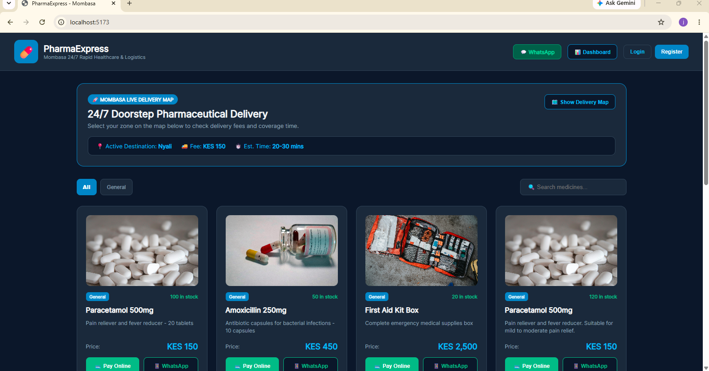
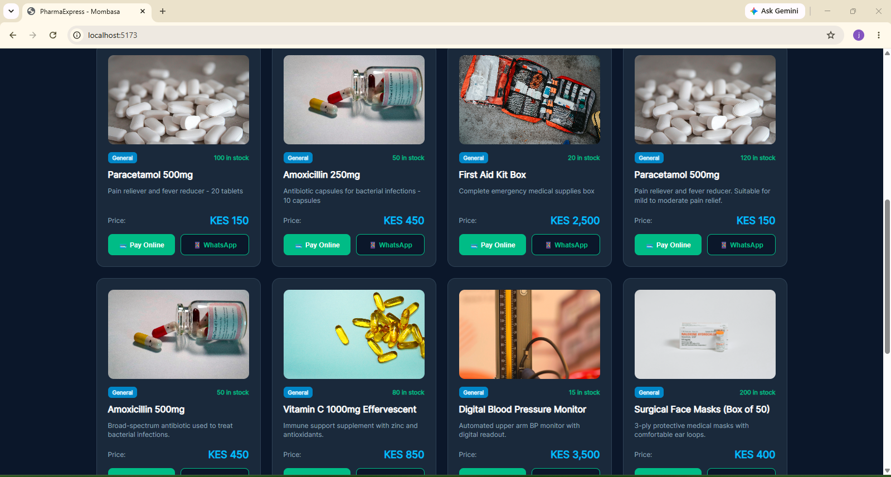
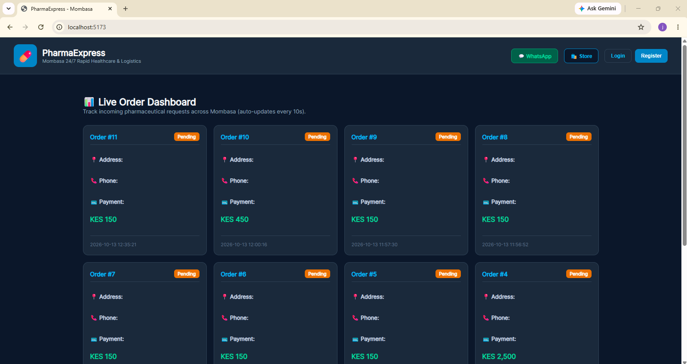
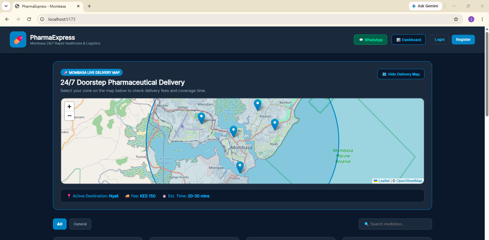

# PharmaExpress - Real-Time Pharmaceutical Ordering & M-Pesa Payment Platform

A full-stack web application designed for rapid pharmaceutical ordering and delivery logistics, featuring live order tracking and secure M-Pesa STK Push payment integration.

---

## Features

* **Interactive Storefront:** Browse medical products, view live pricing, and manage a dynamic shopping cart.
* **M-Pesa Daraja API Integration:** Secure STK Push payment triggering for mobile money checkout.
* **Live Order Dashboard:** Real-time monitoring of incoming orders with automated status updates (Pending/Completed).
* **Secure Webhook Handling:** PHP backend callbacks configured via Ngrok for testing transaction lifecycles.
* **Environment Security:** Strict configuration isolation using `.env` files and `.gitignore` protocols.

---

## Technology Stack

* **Frontend:** React (Vite), JavaScript, CSS3
* **Backend:** PHP (Native REST endpoints, PDO database abstraction)
* **Database:** MySQL / XAMPP Local Server
* **Payment Gateway:** Safaricom Daraja Sandbox API (STK Push & Callbacks)
* **Networking:** Ngrok (Public Tunneling for Webhooks)
* **Version Control:** Git & GitHub

---

## 📷 Application Preview

### Storefront & Catalog

### Products & Cart Management

### Live Order Dashboard

### Delivery Logistics & Mapping

---

## Author
Built by [ATHMAN-RLD](https://github.com/ATHMAN-RLD) as a portfolio-grade full-stack engineering project. 